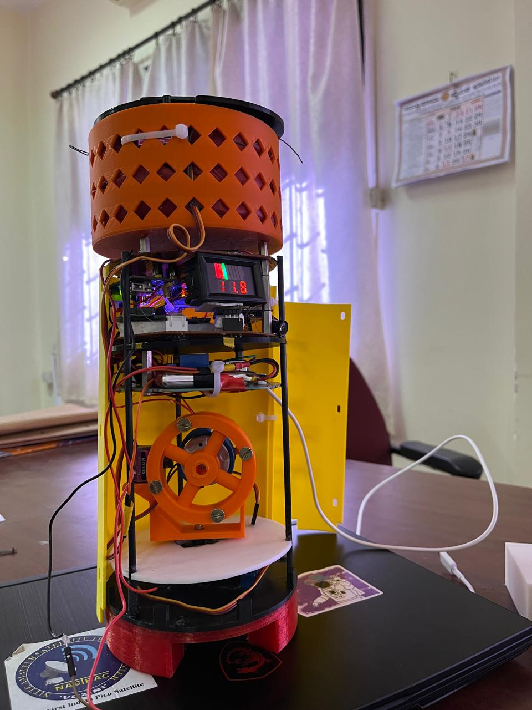

# NMITSat_FCS

Flight control software for the **NMITsat CanSat**, running on a **Teensy 4.1** onboard computer (OBC).

The OBC collects sensor data, logs it to microSD, downlinks telemetry to the Ground Control Station over **XBee**, and can trigger an **ESP32-CAM** from GCS commands.



## Features

- GPS (TinyGPS++) + BME680 environment + MPU6050 IMU sampling
- CSV telemetry over XBee (`Serial2`) and USB debug serial
- Onboard SD logging (`data.txt`)
- GCS commands to enable / disable camera trigger
- Buzzer feedback for telemetry and command ACK
- Documented wiring diagram and packet format

## Stack

| Item | Choice |
|------|--------|
| Language | C++ |
| IDE | Arduino IDE + Teensyduino |
| Board | Teensy 4.1 |
| Radio | XBee |
| Optional payload | ESP32-CAM |

## Repository layout

```
NMITSat_FCS/
├── README.md
├── SETUP.md
├── .gitignore
├── firmware/
│   └── nmitsat_fcs/
│       └── nmitsat_fcs.ino      ← flash this
├── docs/
│   ├── wiring.md
│   ├── telemetry.md             ← CSV fields + GCS commands
│   └── assets/
│       ├── circuit-connection.png
│       └── nmitsat.jpeg
└── archive/                     ← original uploads
```

## Quick start

1. Wire the CanSat per **[docs/wiring.md](docs/wiring.md)**
2. Open `firmware/nmitsat_fcs/nmitsat_fcs.ino` in Arduino IDE (Teensy 4.1)
3. Install libraries listed in **[SETUP.md](SETUP.md)** → Upload
4. Serial Monitor @ **9600**; XBee link @ **115200**

## Operational flow

```
Power ON
  → (optional) GCS calibrate / camera / transmit commands
  → Sample GPS + BME680 + MPU6050
  → Log CSV to SD + send CSV via XBee
  → Camera records to its own SD when armed (a,b / c,d)
  → Recovery: ~600 m / ~500 m chute logic planned (see docs/telemetry.md)
  → Landing buzzer until power off (extend in software when sensors ready)
```

## GCS commands (summary)

| Send | Effect |
|------|--------|
| `a,b` | Camera trigger HIGH |
| `c,d` | Camera trigger LOW |

Full packet layout: **[docs/telemetry.md](docs/telemetry.md)**.

## Related

- [MGAS](https://github.com/hemantbuilds/MGAS) — Mono Gimbal Attitude Stabilizer work in the same program
