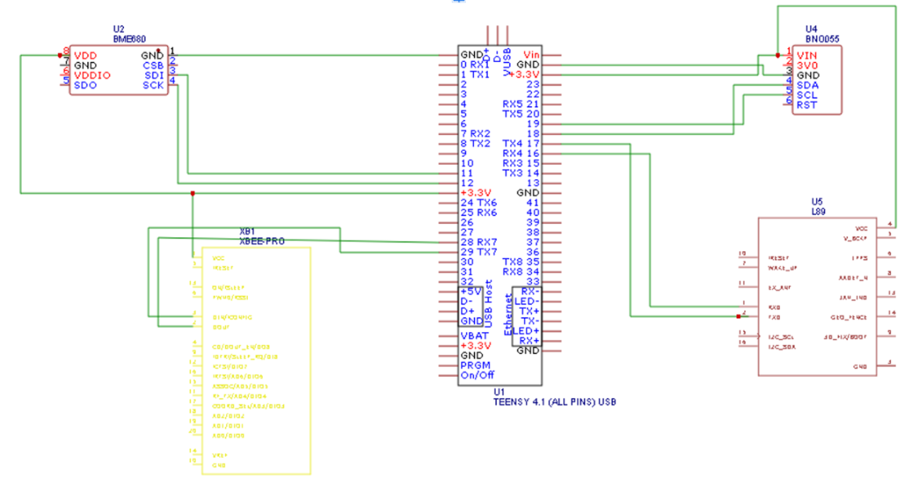
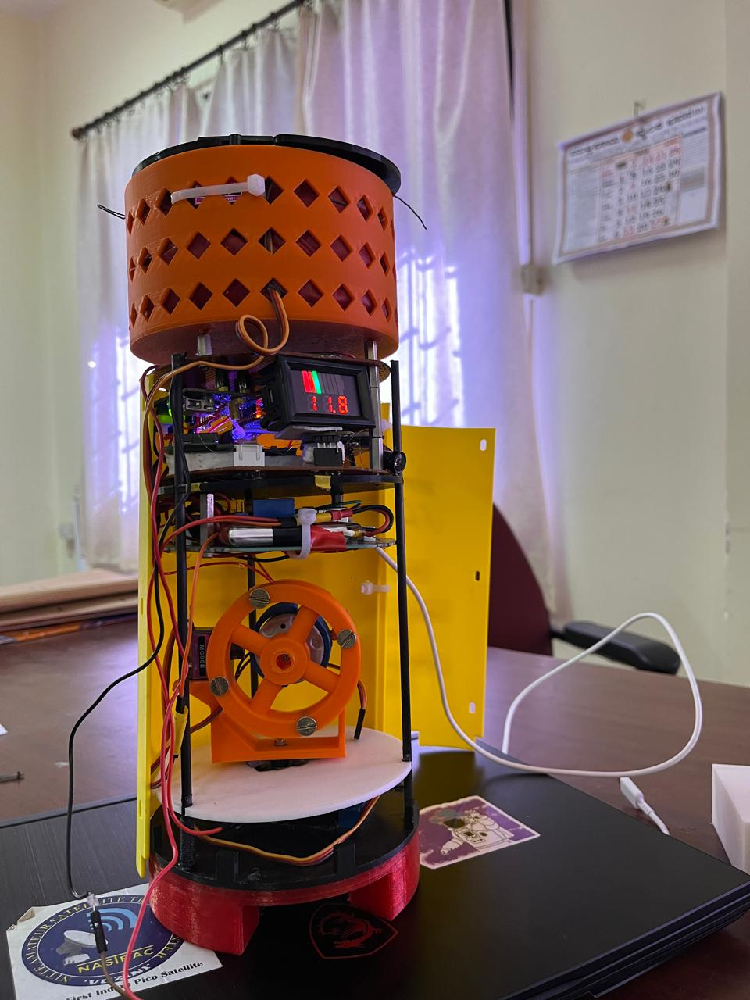

# NMITSat_FCS Wiring

Hardware connections for the CanSat OBC (Teensy 4.1).

## Photos / diagrams

## Board

| Item | Detail |
|------|--------|
| Flight computer | **Teensy 4.1** |
| Storage | Built-in microSD (`BUILTIN_SDCARD`) |
| Radio | XBee on **Serial2** |
| GPS | Hardware **Serial1** (pins 0 / 1) |
| IMU / enviro | MPU6050 + BME680 on **I2C** (`Wire`) |

## Pin map

| Function | Teensy pin | Notes |
|----------|------------|--------|
| GPS RX | **0** (RX1) | GPS TX → Teensy RX1 |
| GPS TX | **1** (TX1) | Optional if GPS is receive-only |
| XBee RX/TX | **Serial2** pins | See Teensy 4.1 card — typically pins **7 (RX2) / 8 (TX2)** |
| Buzzer | **33** | Active high tones |
| ESP32-CAM trigger | **34** | HIGH = record / enable (mission-defined) |
| MPU6050 SDA/SCL | **18 / 19** | Teensy 4.1 default Wire |
| BME680 SDA/SCL | **18 / 19** | Same I2C bus (unique addresses) |
| microSD | Built-in slot | No CS wiring required |

Confirm XBee Serial2 pinout on your carrier / breakout against the [Teensy 4.1 pinout](https://www.pjrc.com/teensy/pinout.html).

## Baud rates

| Link | Baud |
|------|------|
| USB Serial (debug) | 9600 |
| GPS (Serial1) | 9600 |
| XBee (Serial2) | 115200 |

## Power

- Teensy VIN / USB per CanSat power budget
- Common GND across sensors, XBee, camera trigger, buzzer
- ESP32-CAM usually needs its own 5 V rail — pin 34 is a **logic trigger**, not camera power
